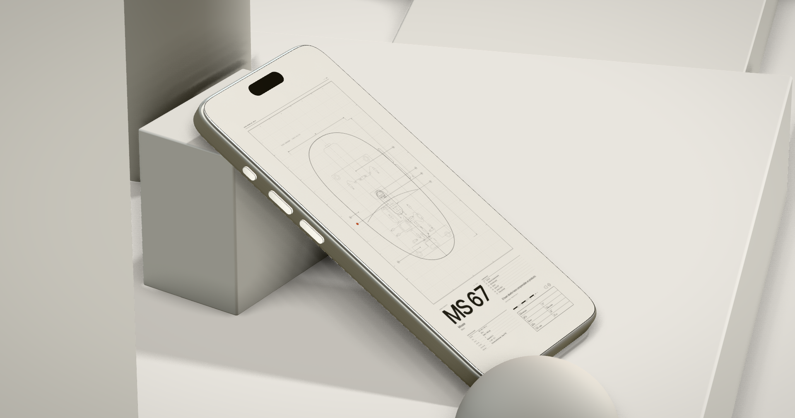

<p align="center">
  
</p>

# Mockup Studio

Fullscreen Three.js iPhone mockup. Drop your screens (images or video), compose the scene, build a camera *cinematic* and export a PNG or a video. Everything runs in the browser, there is no build step, and it works offline once installed.

## Quick start

```bash
npm start          # static server on http://localhost:5173
# or: python3 -m http.server 5173
```

Open <http://localhost:5173> in **Chrome or Edge** (WebCodecs is needed for MP4 export). Do not open `index.html` through `file://`: ES modules need a server. All libraries and fonts are bundled in `vendor/`; the only thing fetched from the internet is a non-default HDRI (and it is cached afterwards).

To try the offline / installable mode open <http://localhost:5173/?sw=1> (the service worker is off on plain localhost).

## Basic use

On the first visit a short card walks you through three steps (reopen it any time with the **?** button).

The **rail** on the left holds the tools (hover a button for its name):

| Button | What it does |
| --- | --- |
| **?** Instructions | Reopens the onboarding |
| **Export** | Opens the export card |
| **Screens** (`D`) | Shows / hides the screens bar at the bottom (hidden by default) |
| **Cinematic** | Opens the cinematics editor |
| **Controles avanzados** | Shows / hides the advanced Controls panel |

1. **Load your screens.** Drag & drop files onto the page, paste from the clipboard, or open the screens bar (**Screens** button or `D`) and use **Cargar**. Images and videos both work. **Reemplazar todo** (on by default): on = new screens replace the current ones, off = they are added. Use the arrows and the trash icon to reorder or delete the selected screen. Your screens are kept in the browser between sessions.
2. **Move the camera.** Drag to orbit, scroll (or pinch) to zoom. You can go low and look up. Double-tap / double-click the scene to re-frame the current shot.
3. **Build the cinematic.** Open the cinematics card: press **Guardar cámara** (or `S`) to save the current view as a *toma* (shot). Click a toma to fly to it, drag the handle to reorder, rename, duplicate or delete it. Tab **Global** sets the rhythm of the whole cinematic (*Move* = travel time, `0` = hard cut; *Hold* = how long each stays; *Loop*, *Random*). Tab **Toma** overrides *Move*, *Hold* and *Ease* for the selected toma only. Presets: Base, Product, Detail, Editorial, Vic. **Copiar JSON** copies the list. The accent button at the top of the actions, **Reproducir cinemática**, plays / stops the cinematic from inside the card (same state as the rail's Play).
4. **Play it.** Press `Space` or the **Reproducir cinemática** button inside the cinematics card. A timeline above the screens bar shows each toma as a dot and fills as it plays (it is never part of an exported image or video).
5. **Export.** Open the export card: pick *Formato* (9:16 by default, 4:5, 1:1, 16:9, 3:2 or *Pantalla*), *Tamaño* (HD → 4K) and *Tipo* PNG or Video; the card shows the exact output size, and for video the estimated file size and frame count. PNG can have a transparent background (*Alpha*, with its own shadow opacity). Video offers *Duración*, FPS, bitrate, codec and mode under **Más ajustes**.

Every downloaded file gets a random 5-character code (`name-XXXXX.ext`).

### Shortcuts

| Key | Action |
| --- | --- |
| `Space` | Play / stop the cinematic (also the accent button in the cinematics card) |
| `S` | Save the current view as a toma |
| `D` | Show / hide the screens bar |
| `←` / `→` | Previous / next screen |
| `Ctrl/Cmd + Z` | Undo (settings and tomas) |
| `Ctrl/Cmd + Shift + Z` / `Ctrl + Y` | Redo |
| `Esc` | Close the open card |

## Controles avanzados (advanced panel)

| Folder | What it controls |
| --- | --- |
| **FPS / Quality** | Frame-rate graph and render quality: **Auto** (lowers resolution only while moving if the FPS drops, and only goes back up when there is clear headroom), **Medium** (a stable ≈ 40 FPS profile: it measures your machine once, fixes the resolution and never changes it again, so there is no flicker; lighter AO, no progressive refinement), **High**, **Max** |
| **Scene** | Palette and colors, solids / ground visibility, floor material (*Real* adds the smudge texture, *Rough*, *Metal*, *Scale*), object positions and presets (*Objs*), HDRI, shadow and AO |
| **Phone** | Body, glass and fingerprints, brushed metal, pose and idle motion |
| **Screens** | Carousel transition (↑ ↓ → ← Fade), timing, parallax, framing of the selected screen |
| **Camera** | Lens (FOV, zoom, easing, fly time, handheld drift and rate) and grade (brightness, contrast, vignette, grain) |
| **UI** | Dim, guide grid / frame toggles, project JSON **Export / Import** and **Cache → Clear** |

Everything you change is saved in your browser automatically.

---

## Advanced

### Video export

- **Offline (default)** renders frame by frame with a virtual clock: the video is smooth no matter how slow the GPU is, and source videos on the screens are synced to that clock. It starts at screen 1 and, if *Shots* is on, plays the cinematic. Duration `Shots` = exactly one pass of it.
- **Realtime** records what you see as it plays, so a slow GPU can drop frames. It is also the automatic fallback when the browser has no WebCodecs.
- **Codec** `Auto` tries MP4 (H.264, then software H.264) and falls back to WebM (VP9, then VP8). If one attempt fails it retries with the next.
- While rendering, the HUD shows percentage, frames and time left, and **Cancelar** stops it.
- If every codec fails, open the browser console (F12): each attempt logs its reason.

### Image quality

- **PNG** is rendered by averaging several jittered samples (8 / 12 / 16 depending on Quality) for clean edges and soft shadows. A toast shows the progress.
- When the scene is completely still (no drift, no animation) the preview refines progressively too.
- Videos on the phone screen use mipmaps, so high-resolution video stays sharp on the small tilted display.

### Cinematic and presets

- **Move = 0** gives instant cuts, also when clicking a toma in the list.
- *Random* / *Count* shorten 1 or 2 random tomas to half their move and hold time on every loop.
- Product, Detail and Editorial are defined relative to the phone, so they follow its pose. **Base** and **Vic** use fixed world coordinates.
- Undo / redo covers tomas and the scene / phone / camera / carousel settings. It does not cover loading or deleting screens, or exports.

### Scene and materials

- *Objs* has a position picker (X / Y / Z) for Tower, Block, Cylinder and Sphere plus the location presets. The slab and the block the phone leans on are fixed.
- Floor and slab can use a realistic physical material (*Real*, off by default) with a procedural, non-repeating smudge texture. *Map R* / *Map M* set how much the texture drives roughness and metalness, *Scale* sets its size.

### Saving, projects and resetting

- Settings and tomas live in `localStorage` (`mockup-studio:v2`); your screens live in IndexedDB. If the browser blocks storage the app still works and tells you once.
- **UI → JSON → Export / Import** saves and loads a whole project file (settings + cinematic + screens; videos over 25 MB are skipped with a notice). Older project files still import; invalid ones are rejected without changing anything.
- **UI → Cache → Clear** wipes saved settings, tomas and screens and reloads with the defaults (asks for confirmation, cannot be undone).

### Project structure

```
index.html      markup + importmap + <script type="module" src="js/main.js">
css/            tokens · main (layout) · export · shoteditor · notices · fonts
js/core/        utils · params (P) · persist · hooks · history · notice · pwa · strings (all user-facing text)
js/three/       renderer · scene · hdri · metal · iphone · screen · smudge · camera · loop · quality · accum · glcontext · formats · frame · session
js/screens/     carousel · examples · load · store
js/ui/          pane.js + pane/ (Tweakpane) · strips · dockToggle · onboarding · exportcard · shoteditor · shotbar · quality · touch
js/export/      export · offline · videosync · project
js/data/        manifests for the example screens and the smudge map
assets/         example screens, smudge map, PWA icons
vendor/         bundled libraries, fonts and the default HDRI
tests/          end-to-end tests (npm test)
tools/          vendor.mjs · sw-list.mjs · unused.mjs · make-icons.py · extract-examples.py
```

New parameters go through `P` so they are saved and exported automatically. See `CLAUDE.md` for the code map, conventions and gotchas.

### Tests

```bash
npm test                          # all end-to-end tests (headless Chrome, software WebGL)
node tests/smoke.test.mjs         # one file
```

After adding or removing files in `js/`, `css/`, `vendor/` or `assets/`, run `node tools/sw-list.mjs` to refresh the offline precache list. `node tools/unused.mjs` reports unused code.

### Use with Claude Code

```bash
claude
```

Read `CLAUDE.md` first.
